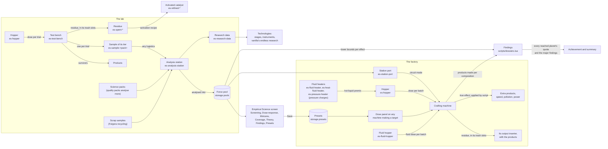
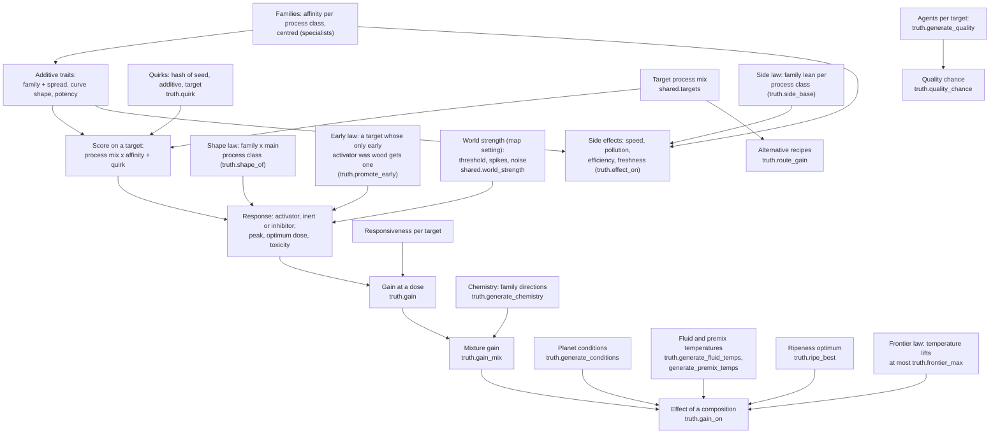
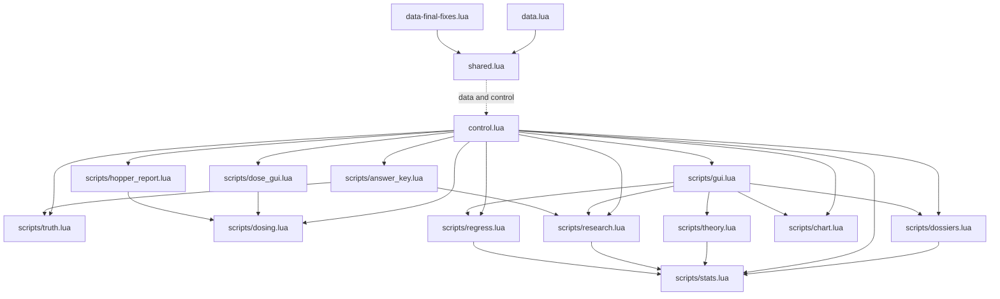
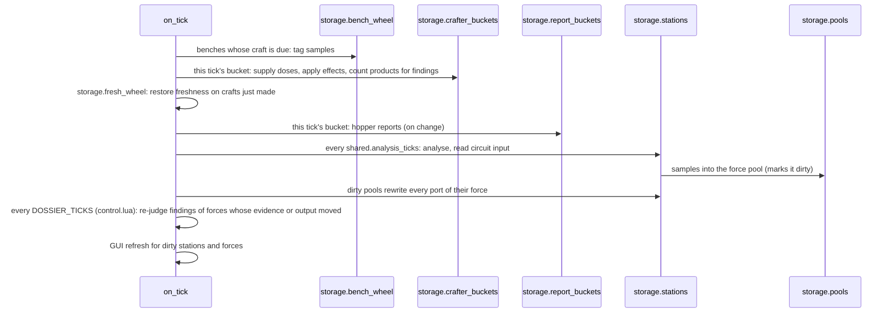
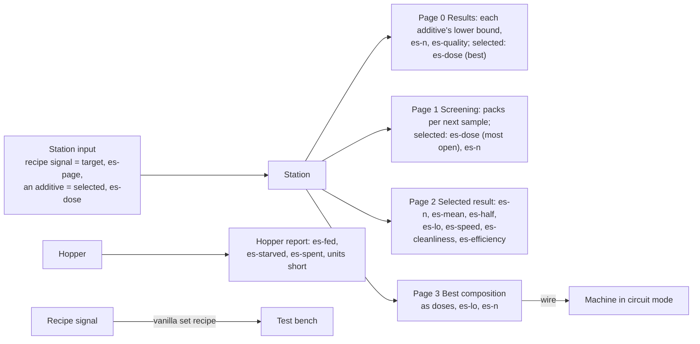

# How Empirical Science works

A maintained map of the mod, for onboarding and for checking assumptions: what is where and how it
flows. `scripts/check.sh` fails when a file,
prototype, signal or `storage` key named here no longer exists, and when a script module, a placeable
entity or one of the mod's signals exists without being named here (`scripts/check_how_it_works.py`).
Values are never typed here: constants are named by where they live (`shared.analysis_ticks`).

## 1. The player's loop

- A **trial** consumes one batch of the target's ingredients. Its yield is the hidden truth plus noise
  (`shared.noise_sd`, scaled by world strength, reduced by precision research), measured with speed,
  pollution, efficiency, freshness (products that spoil) and quality (with an agent).
  The sample carries the measurement in its tags; the tooltip shows them.
- The **station** consumes samples and science packs of the sample's tier
  (`shared.samples_per_pack`) every `shared.analysis_ticks`, and adds them to the force's pool for
  that surface. Pools are per force and per planet (`shared.surface_key`).
- **Production** never displays an effect: the player reads it from production statistics. A machine
  dosed from its hoppers gets the true effect: extra products into its output, a speed nudge, extra or
  removed pollution, power through a hidden `es-power-draw` or `es-power-give`, and on products that
  spoil, freshness: the new units' inherited spoilage is restored by a fraction when each craft completes
  (`storage.fresh_wheel`, checked on the tick, as benches are).
- **Residues** (`es-spent-*`) go into the dosed machine's trash slots (`shared.trash_slots`, given to every
  crafting machine in data-final-fixes) and leave by its output inserter with the products, as spoilage does.
  No room: the dose waits and the machine shows a warning (`storage.trash_full`). Fluid additives and liquid premixes work best at a hidden temperature; heaters set it
  (`shared.heaters`). On new maps some best temperatures lie beyond Nauvis's reach: the pressure heater
  (any planet, burning only pressure charges: tungsten carbide and solid fuel, `shared.pressure_charge`)
  reaches the hot ones; the cold ones: liquid premixes through the fluid chiller (`es-fluid-chiller`,
  `shared.chiller`, burning cold charges, `shared.cold_charge`; `storage.chillers`, the script setting what
  leaves it to the cold), vanilla fluids as chilled twins (`shared.chilled`, made with cold fluoroketone); a
  hopper doses a chilled twin as its fluid. Evidence keeps temperature bands (`shared.temp_band`). A slurry dose
  leaves its solid's residue at the share a unit carries (`shared.residue_shares`); hopper slots take filters.
  Items go into a hopper (`es-hopper`, a chest), fluids into a fluid hopper (`es-fluid-hopper`, a 1x2 tank drawn
  as the pump, 0.71); before 0.71 a fluid port overlaid each hopper, kept hidden so old saves load (`split_hoppers`).
- **Living additives** (Gleba: yumako mash, jelly, nutrients, eggs, bioflux, spoilage) work best at a
  hidden ripeness; a dose records how far its units had spoiled, and evidence keeps ripeness bands
  (`shared.ripe_band`). Space-only targets (`own_stream`) inherit a platform's zero gravity, so their trials
  run only in space. A science pack of higher quality analyses `tool_durability_multiplier` times as many
  samples (`pack_samples`).
- **Findings** (the ending, `scripts/dossiers.lua`; "dossier" in code): a target's proven effect (lower bound
  above its readout's threshold, its planet's own since 0.70 (`dossiers.standard_for`), in one planet's evidence) put into production (`shared.dossier.volume_batches`
  trial batches made with that composition). Thresholds, quotas and each planet's targets come from
  `scripts/dossier_standard.lua` and `scripts/dossier_harsh.lua`, written by `docs/balance.py`.
- **Scrap samples** (Fulgora, `shared.scrap`) come out of scrap recycling; a station draws each one's target,
  additive and dose when it analyses it, capped per cell, with the best pack it holds.
- **Targets** are listed in `shared.targets`: assembled products, science packs, Space Age products
  and, since 0.50, smelting (plates and brick, dosed in furnaces), so quality agents can start a quality
  cascade from raw materials. Targets added later carry `extended` and are drawn by
  `truth.extend_targets`, so no existing world moves. Other mods register targets into the `es-targets`
  mod-data (prototypes built in `data-final-fixes.lua`, the control stage reads the same table); they
  carry `registered` and are drawn by `truth.extend_registered`, from streams keyed by their own name; the
  mod's own later targets (space science, promethium science) carry `own_stream` and are drawn the same way.
  A startup setting derives targets for unregistered science packs (`derive.lua`), guarded on every
  load against the hand-written mixes.
- **Staged reveal**: routes, mixtures, thermal studies and quality agents open with technologies
  (`shared.stages`); circuit features with Lab circuits 1 to 3 (`shared.circuit_tech`).

## 2. The hidden world

Generated once per map in `scripts/truth.lua`, stored in `storage.truth`. Each layer draws from its own
random stream (map seed plus an offset), so adding a layer never changes an existing map's other layers.

- Laws are flags on the world, set when it is made (`truth.generate`): `shape_law`, `temp_axis`, and since 0.70
  `side_law`, `early_law` and `frontier_law`. A world made before a law keeps the old rule; the upgrade test
  checks it.
- The early set (`shared.early`): the tier 1 additives without an `unlock`. Wood waits for Tree seeding on
  new Space Age maps (`shared.unlocked`, read by the dose picker and dosing). The hidden world's guarantee
  still scans the classic five, so no draw moves.
- Activated catalysts take their parent's chemistry and quirks; premixes take their members' (mean).
  Residues take no quirk: their faint hints follow the family.
- The only window onto the truth is `/es-answer-key` (`scripts/answer_key.lua`), and
  `scripts/ground_truth.sh` for the same data outside the game.

## 3. Code: modules

| Module | Owns |
|---|---|
| `shared.lua` | Every tunable and list both stages read: targets, additives, stages, prices, premixes. |
| `data.lua`, `data-final-fixes.lua` | Prototypes: bench, station, port, hoppers, trials, routes, residues, catalysts, premixes, signals, technologies. |
| `data_targets.lua` | A target's prototypes (trials, routes), for the built-in targets and other mods'. |
| `derive.lua` | The derivation rule for other mods' targets and its leave-one-out guard. |
| `control.lua` | Events, the tick loop, trials, analysis, production effects, the port, remotes for tests. |
| `scripts/truth.lua` | The hidden world: generation and every gain or effect lookup. |
| `scripts/dosing.lua` | Machine doses, hoppers, taking additives, residues, presets, blueprints. |
| `scripts/dose_gui.lua` | The dose panel beside a machine's window. |
| `scripts/hopper_report.lua` | Hopper circuit reports. |
| `scripts/gui.lua` | The Empirical Science screen and the station window. Mixtures and Theory join the panel when researched (a hidden tab made the engine misdraw the strip); Coverage counts the evidence per target. |
| `scripts/research.lua` | Break-even, full cost, openness, research data, best composition. |
| `scripts/stats.lua` | Summaries, Welch tests, Wilson intervals. |
| `scripts/regress.lua` | Dose-response model fits. |
| `scripts/chart.lua` | Charts through the factorio-charts library. |
| `scripts/answer_key.lua` | The answer key screen. |
| `scripts/blueprints.lua` | The example builds (dose by signal, dose sweep, best composition to a machine) as blueprint strings, generated by `scripts/make_blueprints.sh` (`tests/es-blueprints`); handed out by the `es-lab-blueprints` shortcut and built in the circuit tips' scenes. Never edited by hand. |
| `scripts/dossiers.lua` | The ending: each target's best proven effect per readout, production counted per composition, planet quotas, the exceptional set, completion (achievement and summary). |
| `scripts/dossier_standard.lua`, `scripts/dossier_harsh.lua` | Dossier thresholds and quotas per world strength, generated by `docs/balance.py` (rule D3); never edited by hand. |
| `scripts/richness_standard.lua`, `scripts/richness_harsh.lua` | Generated by docs/balance.py (the variety rules, V1-V4): the spread of the map's science richness, which sets each target's floor with its trial's lost ore (`research.floor_of`). Never edited by hand. |
| `scripts/showcase.lua` | The main menu scene: vanilla's lab menu save with the mod's machines pasted in (a hand-built layout, `scenes/lab.lua`, from `scripts/scene_workshop.sh`), checked by `scripts/scene_survey.sh --augment`. |
| `scripts/theory.lua` | The Theory tab's model: family affinities fitted to the force's evidence, predictions. |

## 4. Code: the tick loop and state

| `storage` key | Holds |
|---|---|
| `storage.truth` | The hidden world. |
| `storage.pools` | Evidence per force and surface: yield, side effects, quality. |
| `storage.stations` | Each station: port, history, circuit input, the page served; `test_any` (test labs: every slot unfiltered), and `anim`, its working animation while it analyses. |
| `storage.samples_tiered` | Set once samples from before 0.72 (`es-sample`) became their tier's item (`storage.samples_migrated` counts them). |
| `storage.benches` | Each bench, scheduled through `storage.bench_wheel`. |
| `storage.crafters` | Each machine making a target, polled through `storage.crafter_buckets`. |
| `storage.doses` | Each dosed machine's rows, circuit mode and last status. |
| `storage.hoppers` | Each hopper: whether it is a fluid hopper (then it is its own port), reporter, chute and flange drawings. |
| `storage.dossier_made` | Products made by dosed machines, per force, target and composition key (dossier volumes). |
| `storage.dossier_state`, `storage.dossier_seen`, `storage.dossier_dirty`, `storage.dossier_finished`, `storage.dossier_announced` | Dossiers judged per force, when last judged, the tick a force finished, and the findings already announced. |
| `storage.badges` | Each dosed machine's alt-mode dose drawing and the signature it was drawn for. |
| `storage.trash_full` | Machines whose dose waits for room for its residues, and their warning icons. |
| `storage.residue_acc` | Per machine, the part of a residue a slurry dose has left owed (whole residues leave the trash slots). |
| `storage.hopper_links` | Each machine's hoppers (cached). |
| `storage.achieved` | Per force, the achievements it has earned (0.72): granted again to players who join later. `storage.samples_count` and `storage.settled_count` count toward two of them. |
| `storage.notebook` | Per force, the Notebook tab's page (0.72). |
| `storage.dossier_done_at` | Per force, the tick each finding completed (0.72): shown in the Findings tab. |
| `storage.evidence_version` | Bumped by every reading (`stats.add`, 0.72): the screen's and findings' caches rebuild when it moves; `pool.changed[target]` is when a target's evidence last changed. |
| `storage.additives_seen` | Per force, the additives with evidence (0.72): listed on the screen even when the force cannot make them. |
| `storage.analysis_ticks` | The mechanics test's station pace (0.72, set by its hook only); unset in play. |
| `storage.chillers` | Each fluid chiller (0.71), its output set to the chilled cold every 10 ticks. |
| `storage.fresh_wheel` | Freshness-dosed machines, looked at when a craft is due. |
| `storage.presets` | Saved compositions per force. |
| `storage.data_memory` | The lowest openness each question reached (research data is not paid twice). |
| `storage.discovered` | Discovered catalysts per force. |

## 5. The circuit interface

Measurements only, never a fit.

## 6. Assumptions worth checking

Each is enforced somewhere; if you change one, change its guard.

- A new hidden-world feature draws from its own stream: existing maps keep their world (`truth.lua`).
- A registered target never draws from a stream the built-in targets share (`truth.extend_registered`;
  the test leaves it out and adds another, and compares every draw).
- Effects are never displayed in production; players read production statistics.
- The port outputs measurements, never fitted values or "settled" marks.
- Item signals always mean additives; targets are chosen by recipe signal.
- Balance is judged by `docs/balance.py` on sampled worlds, with rules set before the numbers.

## 7. Tooling

| Script | Does |
|---|---|
| `scripts/check.sh` | Lints, then the data and control stages load. |
| `scripts/test.sh` | The headless integration test on a seed (`tests/es-test`). |
| `scripts/guitest.sh` | The GUI test with screenshots (`tests/es-guitest`). |
| `scripts/playthrough.sh` | A scripted playthrough. |
| `scripts/upgrade_test.sh` | Old saves upgraded to the current version. |
| `scripts/perf_test.sh` | The performance scenario (`tests/es-perf`). |
| `scripts/make_blueprints.sh` | Regenerates the example blueprints (`tests/es-blueprints`). |
| `scripts/make_playtest.sh` | Builds the playtest saves, one per theme (`tests/es-playtest-kit`; `all` or a theme). |
| `scripts/sample_worlds.sh` | Samples worlds for `docs/balance.py` (reused when unchanged; `ES_STRENGTH=harsh` for the harsh sample). |
| `scripts/balance.sh` | The balance model at standard and harsh; writes `docs/balance.md` and the findings thresholds. |
| `scripts/ground_truth.sh` | One map's hidden world as JSON (and its best two-additive mixtures). |
| `scripts/world_report.sh` | A seed's field report (`docs/world_report`): the robot's first run, the world's structure, chain leverage, hypotheses derived from the seed's data, per-target best moves; a designer's QA page (spoils the map). |
